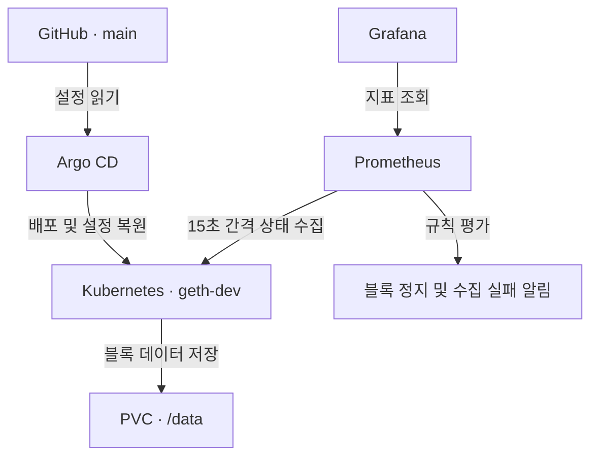

<div align="center">

# bay-node-ops

이더리움 개발 노드의 GitOps 배포와 모니터링


[구성](#구성) · [실행 방법](#실행-방법) · [모니터링](#모니터링) · [실험 결과](#실험-결과)

</div>

## 소개

geth 개발 노드를 Kubernetes에 배포하고, GitHub의 설정 변경을 Argo CD로 자동 반영하는 실습 저장소이다. Prometheus와 Grafana로 노드 상태를 확인하고, 버전 업그레이드와 장애 재현을 통해 데이터 유지, 알림 발생 및 복구 동작을 검증하였다.

| 실습 | 확인한 내용 |
| --- | --- |
| GitOps 배포 | `main` 브랜치의 설정을 Argo CD로 자동 배포 |
| 버전 업그레이드 | geth v1.17.4 → v1.17.5 변경 및 블록 데이터 유지 |
| 장애 감지 | 블록 생성 중단에 따른 두 단계 알림 발생 |
| 변경 복구 | Revert PR 반영 후 블록 생성 재개와 알림 해제 |
| selfHeal | 수동으로 변경한 실행 개수를 Git의 설정으로 복원 |

이 저장소는 `--dev`로 실행하는 로컬 실습 환경을 다룬다. Hoodi 등 외부 테스트넷에 연결하는 구성은 포함하지 않는다.

## 구성



Argo CD는 Git에 저장된 설정을 클러스터에 반영하고, Kubernetes는 해당 설정에 따라 Pod를 실행한다. Prometheus는 geth의 상태 정보를 수집하고 알림 조건을 평가하며, Grafana는 수집한 지표를 그래프로 표시한다.

### 파일별 역할

| 파일 | 역할 |
| --- | --- |
| [argocd/geth-app.yaml](argocd/geth-app.yaml) | 저장소, 배포 경로, 자동 동기화 정책 지정 |
| [k8s/geth-dev.yaml](k8s/geth-dev.yaml) | geth StatefulSet, Service, PVC 구성 |
| [k8s/geth-servicemonitor.yaml](k8s/geth-servicemonitor.yaml) | Prometheus의 수집 대상과 간격 지정 |
| [k8s/geth-alerts.yaml](k8s/geth-alerts.yaml) | 상태 수집 실패와 블록 생성 중단 감지 |

### 주요 설정

| 항목 | 값 | 설정 이유 |
| --- | --- | --- |
| geth 이미지 | `ethereum/client-go:v1.17.5` | 배포 버전 고정 |
| 실행 개수 | `1` | 단일 개발 노드 운영 |
| 블록 생성 주기 | `--dev.period=12` | 12초마다 블록 생성 |
| 데이터 저장 | `/data`, PVC `2Gi` | Pod 교체 후에도 기존 데이터 유지 |
| RPC | `8545` | 버전 및 블록 정보 조회 |
| 상태 수집 | `6060`, `15s` | Prometheus의 주기적인 지표 수집 |
| selfHeal | `true` | 클러스터에서 직접 바꾼 설정 복원 |
| prune | `true` | Git에서 삭제된 리소스를 클러스터에도 반영 |

## 실행 방법

### 1. 준비

Kubernetes 클러스터와 `kubectl`이 필요하다. 실습에서는 Windows의 WSL2 Ubuntu와 kind를 사용하였다.

다음 구성 요소를 먼저 설치한다. 설치 방법은 [Argo CD](https://argo-cd.readthedocs.io/en/stable/getting_started/)와 [kube-prometheus-stack](https://github.com/prometheus-community/helm-charts/tree/main/charts/kube-prometheus-stack)의 공식 문서를 참고한다.

| 구성 요소 | 설치 기준 |
| --- | --- |
| Argo CD | `argocd` 네임스페이스 |
| kube-prometheus-stack | `monitoring` 네임스페이스, Helm 릴리스 이름 `monitoring` |
| 저장 공간 | PVC를 생성할 수 있는 기본 StorageClass |

`ServiceMonitor`와 `PrometheusRule`을 생성하려면 kube-prometheus-stack의 CRD가 먼저 설치되어 있어야 한다. 이 저장소에는 geth 배포 설정이 포함되어 있으며, Argo CD와 모니터링 도구 자체의 설치 파일은 포함되어 있지 않다.

### 2. 저장소 연결

```bash
git clone https://github.com/3DUCK/bay-node-ops.git
cd bay-node-ops

kubectl apply -f argocd/geth-app.yaml
```

다른 저장소로 복사하여 사용하는 경우 `argocd/geth-app.yaml`의 `repoURL`을 변경한다. 이후 `k8s/`의 변경 사항은 PR을 통해 `main`에 반영한다.

### 3. 배포 확인

```bash
kubectl get application geth-dev -n argocd
kubectl get statefulset,pod,service,pvc -n default
```

Argo CD에서 `Synced / Healthy`, StatefulSet에서 `READY 1/1` 상태를 확인한다.

### 4. RPC 조회

별도 터미널에서 포트 연결을 유지한다.

```bash
kubectl port-forward -n default svc/geth-dev 8545:8545
```

실행 중인 geth 버전을 조회한다.

```bash
curl -sS http://localhost:8545 \
  -H 'Content-Type: application/json' \
  -d '{"jsonrpc":"2.0","method":"web3_clientVersion","params":[],"id":1}'
```

실습에서는 다음 버전을 확인하였다.

```text
Geth/v1.17.5-stable-9621c6ad/linux-amd64/go1.26.5
```

## 모니터링

ServiceMonitor는 geth의 `metrics` 포트에서 `/debug/metrics/prometheus` 경로를 15초마다 수집한다. Prometheus의 Targets 화면에서 geth 수집 대상이 `UP`인지 확인한다.

Grafana에서 Prometheus 데이터 소스를 선택하고 다음 세 개의 패널을 구성하였다. 대시보드는 Grafana에서 직접 작성했으며, 이 저장소에는 대시보드 JSON이 포함되어 있지 않다.

| 패널 | PromQL | 확인 목적 |
| --- | --- | --- |
| 블록 높이 | `chain_head_block{job="geth-dev"}` | 블록 번호가 계속 증가하는지 확인 |
| 대기 거래 수 | `txpool_pending{job="geth-dev"}` | 처리 대기 중인 거래 확인 |
| 상태 수집 연결 | `up{job="geth-dev"}` | Prometheus의 수집 성공 여부 확인 |

`up=1`은 상태 정보를 정상적으로 수집했다는 의미이다. 블록 생성 여부는 블록 높이의 변화와 함께 확인해야 한다.

### 알림 기준

| 규칙 | 조건 | 유지 시간 | 등급 |
| --- | --- | --- | --- |
| `GethDown` | `up{job="geth-dev"} == 0` | 1분 | `critical` |
| `GethBlockStalled` | 최근 2분간 블록 번호 변화 없음 | 추가 1분 | `warning` |
| `GethBlockStalledLong` | 최근 5분간 블록 번호 변화 없음 | 추가 1분 | `critical` |

블록 정지 알림은 각각 약 3분과 6분을 기준으로 구성하였다. 실제 관측 시간에는 수집과 규칙 평가 간격 등이 영향을 준다. 세부 조건은 [알림 규칙](k8s/geth-alerts.yaml)에서 확인할 수 있다.

## 실험 결과

2026년 11월 20일 실습에서 확인한 결과이다.

| 실험 | 결과 | 변경 기록 |
| --- | --- | --- |
| 업그레이드 | v1.17.5 실행 확인, 블록 196 → 198로 이어짐 | [PR #1](https://github.com/3DUCK/bay-node-ops/pull/1) |
| 블록 생성 중단 | 블록 높이 264에서 정지, 두 단계 알림 발생 | [PR #2](https://github.com/3DUCK/bay-node-ops/pull/2) |
| 변경 복구 | 블록 생성 재개 및 알림 해제 확인 | [PR #3](https://github.com/3DUCK/bay-node-ops/pull/3) |
| selfHeal | 실행 개수를 0으로 변경한 뒤 1개로 복원, 8초 후 READY 1/1 | 수동 변경 및 Argo CD 이벤트 확인 |

### 시간 기록

| 항목 | 관측값 | 해석 |
| --- | --- | --- |
| 업그레이드 전후 그래프 표시 간격 | 30초 | 실제 서비스 중단 시간을 직접 측정한 값은 아님 |
| Warning 알림 관측 | 장애 PR 병합 후 3분 39초 | 배포 시간과 조회 간격 포함 |
| Critical 알림 관측 | 장애 PR 병합 후 6분 55초 | 배포 시간과 조회 간격 포함 |
| 알림 해제 | 복구 후 Inactive 확인 | 정확한 전환 시각은 별도로 측정하지 않음 |
| 실행 개수 복원 | 변경과 같은 초에 1개로 복원 관측 | 초 단위 기록 기준 |
| Pod 준비 완료 | 변경 후 8초 | READY 1/1 도달까지의 시간 |

### selfHeal 확인 명령

```bash
kubectl scale statefulset geth-dev -n default --replicas=0
kubectl get statefulset geth-dev -n default -w
```

Git에 저장된 실행 개수는 1개이므로 Argo CD가 해당 설정으로 복원한다. `Ctrl+C`로 상태 관찰을 종료할 수 있다.

블록 생성 중단 실험은 `--dev.period=12`를 `--dev.period=0`으로 변경하여 재현하였다. 거래가 없는 동안 블록 생성이 멈추는 설정이며, 실험 후 Revert PR로 기존 값을 복원하였다.

## 실습에서 확인한 점

- PVC를 사용하면 Pod가 교체되어도 기존 블록 데이터를 유지할 수 있다.
- 상태 수집 성공과 블록 생성 여부는 별도로 확인해야 한다.
- selfHeal은 Git과 클러스터의 설정 차이를 복원한다. Git에 저장된 설정 자체의 문제는 모니터링과 변경 검토를 통해 확인해야 한다.
- 클러스터에서 긴급하게 변경한 설정도 복원될 수 있다. 변경 내용을 유지하려면 Git에도 반영해야 한다.

## 참고 문서

- [Argo CD 자동 동기화와 selfHeal](https://argo-cd.readthedocs.io/en/stable/user-guide/auto_sync/)
- [Prometheus 알림 규칙](https://prometheus.io/docs/prometheus/latest/configuration/alerting_rules/)
- [Geth 개발 모드](https://geth.ethereum.org/docs/developers/dapp-developer/dev-mode)
